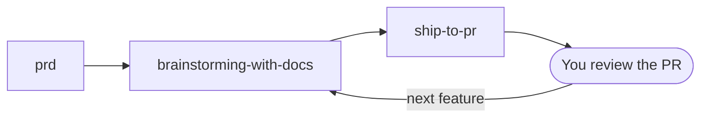

# mad-poco-powers

> [!WARNING]
> **Experimental.** This plugin is a personal experiment in how to work with coding agents. Its skills change often, its process hasn't been proven on many projects, and it overrides parts of superpowers' workflow (it waives plan review and pushes branches when you choose "Ship to PR"). Read the skills before relying on it.

A Claude Code plugin that sits next to [obra/superpowers](https://github.com/obra/superpowers). It changes the part before planning starts, keeps superpowers' work in line with your PRD, and turns an approved design into a pull request in one step:

- **Brainstorming** works like superpowers' `brainstorming` (spike / bounded / architectural paths, hard approval gates, written spec, handoff to `writing-plans`). The difference is that questions come in Matt Pocock's **grilling** rounds, and the project's **glossary and ADRs** are updated as decisions are made.
- **Grilling** is Matt Pocock's interview, changed to use Claude Code's question picker (`AskUserQuestion`) for questions with known alternatives. Open questions still go in chat.
- **Domain modeling** and **codebase design** are Matt Pocock's skills, copied unchanged.
- **PRD** produces the BMad Method's PRD (templates, ids, assumption tags, review and finalize) through a grilling interview instead of BMad's coaching. No installer, no `_bmad/` folder, no agent personas, no ticket tree.
- **PRD check** compares designs, plans and code changes with the PRD and asks you, for each mismatch, whether to amend the PRD or change the work.
- **Ship to PR** does "write the plan, implement it with subagent-driven development, open a PR I can review" in one step, with a concise but complete PR description.

## Hypotheses

The plugin is built on three beliefs. If they turn out wrong, the skills should change.

1. **A precise domain language is crucial.** Humans and agents should use the same words for the same things, in conversation, documents and code. Terms are settled as soon as they're ambiguous, written to `GLOSSARY.md`, and used everywhere after that.
2. **The PRD describes virtually all user-observable behavior, eventually.** It doesn't have to be complete at the start: it begins with intent, users, scope and non-goals, and every behavior decided later is written into it when it's decided. It stays the single description of what the product does; implementation never goes in it.
3. **Feedback on running software beats reading specs, plans or code.** For product and UX decisions, trying the thing gives better feedback than reading about it, so the loop gets to something runnable quickly. Decisions that are expensive to reverse (data model, public APIs, security, data deletion) are still reviewed on paper.

How the skills follow from them:

- (1) `domain-modeling` runs in every PRD session and every brainstorm except quick spikes; plans name code after glossary terms; `prd-check` flags term drift.
- (2) `prd-check` treats new user-observable behavior as a proposed PRD amendment, at the spec, the plan, the branch and any ad-hoc change; the PRD splits into feature PRDs instead of being trimmed.
- (3) Brainstorming offers a throwaway prototype when you can't judge behavior in the abstract; every PR opens with "How to try it".

Superpowers still does the actual work after the spec: `writing-plans`, `subagent-driven-development`, `executing-plans`, TDD, debugging, review and `finishing-a-development-branch`. `ship-to-pr` only chains them.

## Skills

| Skill | What it does | Source |
|---|---|---|
| `brainstorming-with-docs` | Replaces `superpowers:brainstorming`. Classifies the request, asks questions in rounds over a design tree (every question that can be asked now goes in one round, each with a recommended answer), updates `GLOSSARY.md` / `docs/adr/` as the interview goes, designs deep modules, writes the spec, then asks whether to ship to a PR or write the plan and stop. Raises PRD contradictions as questions while it grills. | superpowers `brainstorming` + Matt Pocock `grilling` / `grill-with-docs` |
| `grilling` | Design-tree interview in rounds: every question that can be asked now, each with a recommended answer. Closed questions go through `AskUserQuestion` (recommended option first, `preview` for comparing sketches); open questions such as purpose or a user story go in chat. Facts are looked up by subagents; only decisions go to you. | Matt Pocock `grilling`, adapted |
| `domain-modeling` | Challenges and sharpens domain terms, keeps `GLOSSARY.md`, and offers an ADR only for decisions that are hard to reverse, surprising, and the result of a real trade-off. | Matt Pocock, unchanged |
| `codebase-design` | Shared vocabulary for deep modules: module, interface, depth, seam, adapter, leverage, locality. Includes Deepening and Design It Twice. | Matt Pocock, unchanged |
| `prd` | Grills you into a PRD (full or light). The template's sections are the branches of the design tree; journeys and requirements are drafted from your answers and put back to you to accept. Ends with reviewer subagents, an id check and a finalize pass. The PRD is living: the first version holds what's decided, and it grows (splitting into feature PRDs) as behavior is decided. | BMad Method `bmad-agent-pm` templates + `bmad-facilitate` review/finalize, with grilling as the interview |
| `prd-check` | Compares a design, spec, plan or branch with the PRD. Sorts mismatches into contradictions, extensions, gaps and term drift; asks you per mismatch (picker, proposed PRD text in the preview) whether to amend the PRD, change the work, or record an open question, recommending "amend the PRD" for behavior someone decided; amends the PRD without reusing ids. While a plan executes it never stops to ask: it follows the already-checked spec, records differences, and asks at the check before the PR. | new |
| `ship-to-pr` | For an approved spec: `writing-plans` (plan review waived) → PRD check on the plan → `subagent-driven-development` → PRD check on the branch → `finishing-a-development-branch` with "push and create PR" chosen. For an approved bounded design: worktree branch → TDD → PRD check → PR. For finished work (on a feature branch, or moved off the base branch without `reset --hard`): PRD check → PR. Never merges. Writes the PR description: summary, how to try it (verified steps, screenshots for UI changes), behavior-level changes, every ruling made during implementation, spec deviations, PRD/glossary/ADR changes, review focus, testing and gaps, follow-ups; empty sections dropped, about one screen. | new, chains superpowers |

## How they fit together



You start with a PRD, then repeat brainstorm → ship to PR → review for each feature. The agent invokes the other skills (`grilling`, `domain-modeling`, `codebase-design`, `prd-check` and the superpowers skills `ship-to-pr` chains) on its own when they're needed.

- Once a PRD exists, specs, plans and branches are checked against it. `prd-check` runs on the spec, the plan and the branch, and on any other change that adds or changes user-observable behavior (a debugging fix, say). Each mismatch becomes a question: amend the PRD or change the work. PRD amendments are committed on the same branch, so they show up in the PR.
- `GLOSSARY.md` is the only place domain terms are defined. The PRD's Glossary section links to it and does not define terms itself.
- ADRs follow Matt Pocock's format: `docs/adr/NNNN-slug.md`, a paragraph is fine.

### Files written into your project

| Path | Written by |
|---|---|
| `docs/prd/<slug>.md` | `prd` |
| `docs/superpowers/specs/YYYY-MM-DD-<topic>-design.md` | `brainstorming-with-docs` (same path superpowers uses, so `writing-plans` finds it) |
| `GLOSSARY.md` (or `GLOSSARY-MAP.md` + per-context glossaries) | `domain-modeling` |
| `docs/adr/NNNN-<slug>.md` | `domain-modeling` |
| `docs/superpowers/plans/YYYY-MM-DD-<feature>.md` | superpowers `writing-plans` (via `ship-to-pr`) |

## Installation

Install superpowers first, then this plugin:

```text
/plugin marketplace add marcusleg/mad-poco-powers
/plugin install mad-poco-powers@mad-poco-powers
```

For a local checkout: `/plugin marketplace add /path/to/mad-poco-powers`.

### How it hooks into superpowers

A plugin can't edit or turn off another plugin's skills, so this plugin's `SessionStart` hook adds instructions to every session:

- Use `mad-poco-powers:brainstorming-with-docs` wherever superpowers says `superpowers:brainstorming`, and never run both. The superpowers skill stays installed and is simply not used.
- Use `ship-to-pr` when you say to write the plan and implement it, or to open a PR.
- **When the repo has a PRD in `docs/prd/`:** run `prd-check` after `writing-plans`, before `finishing-a-development-branch`, and after any change that adds or changes user-observable behavior. The PRD is looked for when it matters, so a PRD written mid-session counts too.

If Claude picks the wrong skill, name the one you want: "use brainstorming-with-docs".

## Not included, on purpose

- Matt Pocock's `grill-me` / `grill-with-docs` shortcuts: use `grilling` directly, or `brainstorming-with-docs`, which already combines grilling with domain-modeling.
- BMad's brain-dump / coaching / fast-path facilitation (replaced by grilling), memlog, party mode, advanced elicitation, HTML views, ticket tree, PO/UX/architecture agents, and its other planning templates.

## Credits and license

MIT. Built from MIT-licensed work by Jesse Vincent ([obra/superpowers](https://github.com/obra/superpowers)), Matt Pocock ([mattpocock/skills](https://github.com/mattpocock/skills)) and BMad Code, LLC ([BMAD-METHOD](https://github.com/bmad-code-org/BMAD-METHOD)). See [THIRD_PARTY_NOTICES.md](THIRD_PARTY_NOTICES.md) for versions and licenses.

This is an independent project. It is not affiliated with, endorsed by or certified by any of these authors. BMad™ and BMad Method™ are trademarks of BMad Code, LLC; they are used here only to name where material came from.
