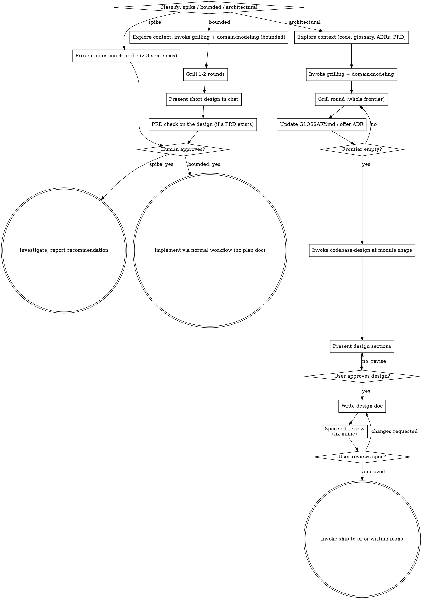

# Brainstorming With Docs

Turn ideas into fully formed designs and specs through a relentless,
collaborative interview, and leave the project's domain language and hard
decisions written down as you go.

This skill is superpowers' `brainstorming` process (paths, gates, spec,
handoff to `writing-plans`) driven by Matt Pocock's `grilling` interview
(design tree, frontier rounds, recommended answers) with his
`domain-modeling` and `codebase-design` disciplines running alongside.
Where `superpowers:brainstorming` would apply, use this skill instead.

Start by classifying how much process the request needs, then work
through your path: understand the context, grill the idea into shape,
present a design, and get your human partner's approval.

## Companion skills

- **grilling** — on the bounded and architectural paths, invoke it with
  the Skill tool after exploring project context, before the first round. Every question in this skill is
  asked by its rules: rounds over the design tree, closed questions
  through AskUserQuestion with your recommendation first, open questions
  in chat.
- **domain-modeling** — on the bounded and architectural paths, invoke it
  with the Skill tool together with grilling. Its rules apply for the
  rest of the session: challenge terms against `GLOSSARY.md`, sharpen
  fuzzy language, stress-test with concrete scenarios, cross-reference the
  code, update `GLOSSARY.md` the moment a term resolves, and offer ADRs
  sparingly. Skip it on a spike.
- **codebase-design** — invoke it when the design reaches module shape:
  where seams go, what an interface hides, how it is tested. Use its
  vocabulary (module, interface, depth, seam, adapter, leverage, locality)
  in the design and the spec.
- **prd** — if `docs/prd/` holds a PRD for this work, read it during
  context exploration: its FR/UJ/RULE ids are settled requirements, and
  the spec cites them instead of restating them. If the request is a new
  product with real stakes and no PRD, offer the `prd` skill once, before
  the first round. The user can decline; brainstorming works without one.
- **prd-check** — when a PRD exists, hold every answer against it as it
  lands. The moment an answer contradicts an FR, RULE or non-goal, or
  extends the product beyond the PRD, raise it as a closed question in
  the next round (amend the PRD, or change the design), quoting the PRD
  line. Then run `prd-check` formally on the written spec (bounded path:
  on the in-chat design, before asking for approval).
- **ship-to-pr** — offered when the design is approved (see User Review
  Gate): it writes the plan, implements via subagent-driven development,
  runs prd-check, and opens a PR.

## Establish Shared Understanding

The outcome of brainstorming is an understanding your human partner can
recognize and correct, grounded in what they want to accomplish.

1. **Discover intent.** Use the request and available context to identify
   the intended outcome, who it is for, and what success looks like. When
   that information is missing, it belongs in the first grilling round,
   before features or an approach. Knowing the app genre does not tell you
   why your partner wants it. Gathering missing requirements does not ask
   them to authorize the task again.
2. **Write back your understanding.** Summarize the intended outcome,
   relevant constraints, and success criteria in a short note your partner
   can assess. Separate what they said from assumptions. Invite correction
   and incorporate their answer before treating this as the design brief.
3. **Carry intent into the design.** Preserve the agreed understanding in
   the selected path's design artifact: the written spec for architectural
   work, or the in-chat design/probe for bounded work and spikes. Check
   proposed features and technical choices against that understanding.

When the request (or a PRD) already supplies the purpose and constraints,
reflect that understanding instead of asking the same questions again.

<HARD-GATE>
Before taking any implementation action, including invoking an
implementation skill, writing product code, scaffolding, installing
product dependencies, or creating an external project, complete the
selected path's prerequisites:

- Spike: the human partner approves the question and probe.
- Bounded: the human partner approves the short in-chat design.
- Architectural: the human partner reviews and approves the written spec,
  then either reviews the written implementation plan and selects its
  execution method, or chooses Ship to PR, which pre-approves the plan
  and selects subagent-driven execution. Conversational design approval
  only permits writing the spec; written-spec approval only permits
  invoking writing-plans, or ship-to-pr when that is what they chose.

A reply approves the stage actually presented. Approval of an idea or
feature scope does not approve artifacts that do not exist yet. Resume
at the earliest incomplete stage; do not turn one approval into permission
to skip the rest of the selected path. Read-only project exploration is
allowed while those prerequisites remain incomplete. Writing
`GLOSSARY.md` and ADRs is documentation, not implementation, and is
allowed during the interview. A throwaway prototype offered under "Try
it instead of asking" is a spike inside this session: your partner's yes
to that offer approves the prototype and nothing else. It lives in a
scratch directory outside the repo (or a throwaway branch), any
dependencies are installed only there, it is never committed to the
work, and it is deleted before the interview resumes. It approves no
implementation and no design.
</HARD-GATE>

## Three Paths

Before your first question, classify the request and say the
classification out loud — "this looks bounded, so I'll grill you briefly
and present a short design here rather than write a spec" — so your
human partner can override it:

- **Spike** — a feasibility question ("can we...", "is it possible...",
  "quick and dirty is fine") whose output is an answer, not code you
  keep. Present the question and what you'll try in 2-3 sentences, get
  a nod, then find out as cheaply as correctness allows. No grilling,
  no glossary, no spec file. Report findings as a recommendation;
  anything you built stays labeled throwaway.
- **Bounded** — a well-scoped change to code that already exists in
  this repo: a new flag, a small endpoint, a one-file fix.
  Understanding the kind of app is not enough — bounded means the flow
  you are changing is already here to read. If there is no existing
  flow to change, the task is not bounded. Grill only the decisions that
  matter (often one round), present a short design IN CHAT (a few
  sentences to a few short paragraphs), and STOP. Implementation
  starts only after your human partner says yes to that design — a
  bounded task's approval is as hard a gate as an architectural
  one. No spec file, no implementation plan document.
- **Architectural** — new projects, new subsystems, changes that
  restructure how components fit together or alter interfaces others
  depend on. Follow the full process: grilling rounds until the frontier
  is empty, approaches, sectioned design, written spec, then ship-to-pr
  or the writing-plans skill.

When in doubt between two paths, take the heavier one. The ratchet is
one-way: hidden complexity discovered mid-task upgrades the path —
stop, say so, and step up. Nothing downgrades mid-task.

## Grilling: How Questions Are Asked

Run the interview by the **grilling** skill: a design tree worked in
rounds, each round the whole frontier, closed questions through
AskUserQuestion (recommended option first), open questions in chat,
facts found by subagents, decisions put to your partner.

For a design, the tree usually grows in this order, but follow the
dependencies, not the list:

1. Purpose, audience, success criteria, hard constraints (mostly open
   questions)
2. Scope edges: what is in, what is explicitly out (YAGNI ruthlessly)
3. Domain terms and their boundaries (domain-modeling scenarios live here)
4. Approach: 2-3 options with trade-offs, your recommendation first (a
   closed question; use `preview` for interface or architecture sketches)
5. Module shape: seams, interfaces, dependency categories (codebase-design)
6. Error handling, data flow, testing strategy

**Docs as you go.** While answers land, follow domain-modeling: when a
term resolves, update `GLOSSARY.md` in the same turn; when a decision is
hard to reverse, surprising without context, and the result of a real
trade-off, offer an ADR in `docs/adr/`. Mention each write in one line in
your next round so your partner can object.

The interview is done when the frontier is empty: every branch visited,
nothing left silently assumed. Do not act on it until your partner
confirms you have reached a shared understanding.

## Anti-Pattern: "Too Simple To Need Approval"

Every path ends with your human partner approving the required design
before implementation. A bounded change may need only two sentences in
chat. A new todo-list project is architectural and requires the written
spec and planning handoffs. Scale the artifact to the selected path;
complete that path's reviews before implementation.

## Red Flags

| Thought | Reality |
|---------|---------|
| "This is too simple to need a design" | Follow the selected path: a bounded change gets a short chat design; an architectural change gets the written spec and planning handoffs. |
| "I'll call it bounded and skip the spec" | Reaching for a label to skip work IS the doubt — take the heavier path. |
| "It's bounded and the design is obvious — I'll start while they read it" | The gate is the approval, not the design's length. Present, then stop until you hear yes. |
| "I understand this kind of app, so it's bounded" | Bounded measures the repo, not your familiarity. A new project has no existing flow — it is architectural. |
| "The spike works, so I'll keep the code" | A spike's output is an answer. Keeping the code is a new request — classify it. |
| "It grew, but I'm almost done — no need to re-classify" | Hidden complexity upgrades the path mid-task. Stop and say so. |
| "They approved the spike, so the follow-up change is approved too" | Each task gets its own classification and its own approval. |
| "I'll ask which file handles X" | That's a fact. Dispatch a subagent; ask only for decisions. |
| "I'll ask Q3 now even though it depends on Q1" | Dependent questions wait for a later round. |
| "I'll batch the glossary updates at the end" | Terms are written the moment they resolve. |
| "This decision deserves an ADR" (but it's easy to reverse) | All three ADR criteria or no ADR. |
| "They said yes, so every recommendation is accepted" | A yes accepts the questions in that round. Anything you added outside a question is still open. |
| "I'll offer options for 'what is this for?'" | Purpose is an open question. Ask it in chat; don't put words in their mouth. |

## Checklist

Classify first, announce the path, then create a task for each item on
your path and complete them in order.

**Spike:**
1. **Explore project context** — enough to frame the probe
2. **Present question + probe plan** — 2-3 sentences
3. **Get approval** — a nod is enough
4. **Investigate** — as cheaply as correctness allows
5. **Report findings** — a recommendation; label anything built as throwaway

**Bounded:**
1. **Explore project context** — files, docs, recent commits, `GLOSSARY.md`, relevant ADRs
2. **Invoke grilling and domain-modeling**
3. **Grill** — one or two rounds on the decisions that matter
4. **Present short design in chat** — approach, files touched, testing, in glossary terms
5. **PRD check** — if a PRD exists, run prd-check on the design and settle its questions before asking for approval
6. **Get approval** — STOP and wait for an explicit yes; presenting the design and starting in the same breath is skipping the gate. Ask with AskUserQuestion: approve and ship to a PR (ship-to-pr), approve and implement here, or change something
7. **Implement** — via ship-to-pr, or the normal development workflow (TDD applies); no plan document either way

**Architectural:**
1. **Explore project context** — files, docs, recent commits, `GLOSSARY.md` / `GLOSSARY-MAP.md`, `docs/adr/`, any PRD in `docs/prd/`
2. **Invoke grilling and domain-modeling**
3. **Offer the visual companion just-in-time** — NOT upfront. The first time a question would genuinely be clearer shown than described, offer it then (its own message). If no visual question ever arises, never offer it. See Visual Companion below.
4. **Write back your understanding** — after the first round on purpose and success
5. **Grill in rounds until the frontier is empty** — decompose first if it's several independent subsystems
6. **Propose 2-3 approaches** — as a frontier question, with trade-offs and your recommendation
7. **Invoke codebase-design** — when the tree reaches module shape; offer Design It Twice for the riskiest interface
8. **Present design** — in sections scaled to their complexity, get approval after each section
9. **Write design doc** — save to `docs/superpowers/specs/YYYY-MM-DD-<topic>-design.md` and commit (with any glossary/ADR changes)
10. **Spec self-review** — inline check for placeholders, contradictions, ambiguity, scope, glossary drift, and prd-check against the PRD (see below)
11. **User reviews written spec** — ask your partner to review the spec file, and how to continue
12. **Transition to implementation** — invoke ship-to-pr, or writing-plans if they want to review the plan first

## Process Flow

(codebase-design may be invoked earlier, as soon as module-shape
questions reach the frontier; the diagram shows the latest point.)

**Terminal states are path-bound.** Architectural: the ONLY
implementation-side skills you invoke after brainstorming are ship-to-pr
(which runs writing-plans itself) or writing-plans — never
frontend-design, mcp-builder, or any other implementation skill.
(grilling, domain-modeling, codebase-design, prd and prd-check are
design-side companions and may be invoked during the session.) Bounded:
after approval, implementation proceeds through ship-to-pr or the normal
development workflow; no plan document. Spike: the terminal state is a
reported recommendation.

## The Process

The subsections below serve the bounded and architectural paths (a
spike stops at "present the probe, get a nod"). Sections from
**Exploring approaches** onward are architectural-path depth — for
bounded work, context plus a round or two plus a short in-chat design is
the whole process.

**Understanding the idea:**

- Check the current project state first (files, docs, recent commits,
  glossary, ADRs, PRD). Use subagents for broad sweeps.
- Before the first round, assess scope: if the request describes multiple
  independent subsystems (e.g., "build a platform with chat, file storage,
  billing, and analytics"), flag this immediately. Don't grill details of
  a project that needs to be decomposed first.
- If the project is too large for a single spec, make decomposition the
  first frontier: what are the independent pieces, how do they relate,
  what order should they be built? Then brainstorm the first sub-project
  through the normal flow. Each sub-project gets its own spec → plan →
  implementation cycle.
- Closed questions (known alternatives) go through AskUserQuestion;
  purpose and discovery stay open questions in chat (see grilling).

**Try it instead of asking:**

- When a question is about how something should look, feel or behave,
  and your partner can't judge it in the abstract (they'd say "I'll know
  it when I see it"), stop grilling that branch. Offer a quick,
  throwaway prototype they can run (a spike inside this session, built
  in a scratch directory outside the repo; see the HARD-GATE), then
  delete it and return to the tree with what they decided. The decided behavior goes
  into the design, and into the PRD via prd-check.
- Don't do this for decisions that are expensive to reverse (data
  model, public APIs, security, anything that deletes data): those are
  settled on paper.

**Exploring approaches:**

- Put 2-3 approaches to your partner as a single frontier question, with
  trade-offs, your recommendation first and why
- YAGNI ruthlessly - remove unnecessary features from every approach

**Presenting the design:**

- Once the frontier is empty, present the design
- Scale each section to its complexity: a few sentences if
  straightforward, up to 200-300 words if nuanced
- Ask after each section whether it looks right so far
- Cover: architecture, modules and their interfaces, data flow, error
  handling, testing
- Use glossary terms exactly; a new noun in the design is a glossary
  question first
- Be ready to go back and clarify if something doesn't make sense

**Design for depth (codebase-design):**

- Prefer deep modules: a lot of behaviour behind a small interface, at a
  clean seam, testable through that interface
- For each module, answer: what is its interface (including invariants,
  ordering, error modes), what does it hide, what does it depend on, and
  which dependency category is that (in-process, local-substitutable,
  remote-but-owned, true external)?
- Apply the deletion test: if deleting a proposed module would make
  complexity vanish, it's a pass-through — merge it
- One adapter is a hypothetical seam; don't introduce a port unless at
  least two adapters (typically production + test) justify it
- The interface is the test surface: plan tests at module interfaces,
  not past them
- For the riskiest interface, offer Design It Twice (parallel subagents,
  radically different interfaces, then compare on depth, locality and
  seam placement) — see codebase-design's DESIGN-IT-TWICE.md

**Working in existing codebases:**

- Explore the current structure before proposing changes. Follow existing
  patterns.
- Where existing code has problems that affect the work (e.g., a shallow
  module, a misplaced seam, tangled responsibilities), include targeted
  deepening as part of the design.
- Don't propose unrelated refactoring. Stay focused on what serves the
  current goal.
- When the code contradicts what your partner says about the domain,
  surface it as a question (domain-modeling: cross-reference with code).

## After the Design (architectural path)

**Documentation:**

- Write the validated design (spec) to
  `docs/superpowers/specs/YYYY-MM-DD-<topic>-design.md` (user preferences
  for spec location override this default)
- Use domain terms exactly as `GLOSSARY.md` defines them; link the
  glossary and any ADRs the design rests on rather than restating them
- When a PRD exists, cite its ids (FR-N, UJ-N, RULE-N) where the design
  realizes them; don't copy requirements in
- Describe modules in codebase-design vocabulary: interface, seam,
  adapter, dependency category, test surface
- Use elements-of-style:writing-clearly-and-concisely skill if available
- Commit the design document together with any `GLOSSARY.md` and ADR
  changes from the session

**Spec Self-Review:**
After writing the spec document, look at it with fresh eyes:

1. **Placeholder scan:** Any "TBD", "TODO", incomplete sections, or vague
   requirements? Fix them.
2. **Internal consistency:** Do any sections contradict each other? Does
   the architecture match the feature descriptions?
3. **Scope check:** Is this focused enough for a single implementation
   plan, or does it need decomposition?
4. **Ambiguity check:** Could any requirement be interpreted two
   different ways? If so, pick one and make it explicit.
5. **Glossary drift:** Does the spec use any term differently from
   `GLOSSARY.md`, or a synonym listed under `_Avoid_`? Fix the spec, or
   raise it with your partner if the glossary is what's wrong.
6. **PRD check:** If a PRD exists, run `prd-check` on the spec. Unlike
   items 1-5, its contradictions and extensions are not fixed silently:
   each goes to your partner as a question (amend the PRD, or change the
   spec). Commit PRD amendments with the spec.

Fix items 1-5 inline. No need to re-review — just fix and move on. For a
larger spec, you may dispatch a reviewer subagent with
`spec-document-reviewer-prompt.md`.

**User Review Gate:**
After the self-review passes, tell your partner where the spec is
(`<path>`, committed with any glossary, ADR and PRD changes, which you
list in a line each). Then ask with AskUserQuestion how to continue:

- **Ship to PR (Recommended)** — write the plan, implement it with
  subagent-driven development, check it against the PRD, and open a PR
  for review (ship-to-pr)
- **Write the plan, then stop** — for reviewing the plan before any code
  (writing-plans)
- **Change the spec** — they'll say what

Wait for the answer. If they request changes, make them and re-run the
self-review. Only proceed once they approve.

**Implementation:**

- Ship to PR: invoke the ship-to-pr skill
- Plan first: invoke the writing-plans skill, telling it that names in
  code and user-facing text use the terms `GLOSSARY.md` defines
- Do NOT invoke any other implementation skill.

## Visual Companion

A browser-based companion for showing mockups, diagrams, and visual
options during brainstorming. Available as a tool — not a mode. Accepting
the companion means it's available for questions that benefit from visual
treatment; it does NOT mean every question goes through the browser.

**Offering the companion (just-in-time):** Do NOT offer it upfront. Wait
until a question would genuinely be clearer shown than told — a real
mockup / layout / diagram question, not merely a UI *topic*. The first
time that happens, offer it then, as its own message:
> "This next part might be easier if I show you — I can put together
> mockups, diagrams, and comparisons in a browser tab as we go. It's still
> new and can be token-intensive. Want me to? I'll open it for you."

**This offer MUST be its own message.** Only the offer — no grilling
round, summary, or other content. Wait for the response. If they accept,
start the server with `--open` so their browser opens to the first screen
automatically. If they decline, continue text-only and don't offer again
unless they raise it.

**Per-question decision:** Even after acceptance, decide FOR EACH
QUESTION whether to use the browser or the terminal. The test: **would
your partner understand this better by seeing it than reading it?**

- **Use the browser** for content that IS visual — mockups, wireframes,
  layout comparisons, architecture diagrams, side-by-side visual designs
- **Use the terminal** for content that is text — requirements questions,
  conceptual choices, tradeoff lists, A/B/C/D text options, scope
  decisions (grilling rounds stay in AskUserQuestion and chat)

If they agree to the companion, read the detailed guide before
proceeding: `visual-companion.md` in this skill's directory (its
`scripts/` paths are relative to this skill's directory too).
